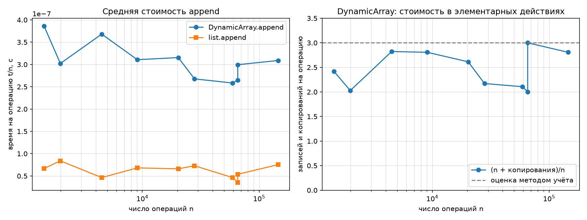
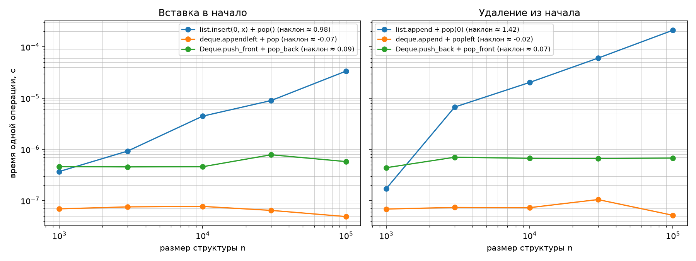

# ЛР 2. Рекурсия и линейные структуры

Вариант 7, seed 37. Для каждой серии выполнен прогрев и пять измерений через perf_counter. На графиках показана медиана. При сравнении операций у начала измерялись 1000 пар «добавить и удалить» при постоянном размере структуры. Подготовка структуры исключена из замера.

## Рекурсия

| n | F(n) | Вызовов без кэша | Вызовов с кэшем |
|---:|---:|---:|---:|
|5|5|15|9|
|10|55|177|19|
|15|610|1973|29|
|20|6765|21891|39|
|25|75025|242785|49|
|30|832040|2692537|59|

Наивная рекурсия вызывает обе ветви заново. Из C(0)=C(1)=1 и C(n)=1+C(n−1)+C(n−2) следует C(n)=2F(n+1)−1. При мемоизации каждое из n−1 значений от 2 до n раскрывается ровно один раз и вызывает две подзадачи. С учётом первого входа получается 2n−1 вызовов при n≥1. Обе версии занимают O(n) памяти по глубине стека, у второй также O(n) записей словаря.

Факториал сводит n к n−1 до 1 или 0, поэтому требует Θ(n) вызовов и O(n) памяти стека. Оценка считает арифметические операции. Для Ханойских башен перенос верхних n−1 дисков освобождает самый большой диск. После его переноса те же n−1 дисков переносятся на целевой стержень. Отсюда H(0)=0 и H(n)=2H(n−1)+1=2ⁿ−1. Глубина стека O(n), сохранённый список ходов занимает Θ(2ⁿ) памяти.

## Сколько стоит append

Назначим каждому добавлению три единицы. Одна оплачивает запись, две остаются в резерве. Между расширениями с ёмкости k до 2k и с 2k до 4k добавляются k элементов. Они оставляют 2k единиц, ровно на копирование полного буфера при следующем росте. Первые четыре добавления также покрывают первое расширение. Поэтому отдельное добавление может стоить Θ(n), а серия из n добавлений требует меньше 3n записей вместе с копированиями.

При 65 536 добавлениях скопировано 65 532 элемента. Следующее добавление переносит ещё 65 536, и счётчик достигает 131 068. Средняя стоимость возрастает с 1,99994 до 2,99991 действия. На всех размерах варианта среднее измеренное время DynamicArray.append составило 0,26–0,39 мкс. Ступенька после расширения видна особенно хорошо по числу копирований.

## Операции у начала и сверка

При росте размера с 1 000 до 100 000 операции у начала list дорожают из-за сдвига ссылок на оставшиеся элементы. Наклоны в log-log составили 0,98 для вставки и 1,42 для удаления. Время включает вторую операцию пары, а стоимость перемещения памяти зависит от размера блока. У обоих деков наклоны по модулю меньше 0,1. Самописный дек меняет только крайние ссылки за O(1). На 100 000 операциях варианта собственный стек оказался в 2,9 раза медленнее list, а дек в 4,6 раза медленнее collections.deque. В измеренное время входят вызовы методов Python и создание узлов.

Все пять разделов self_check прошли при запуске Python с флагом -O. Проверены факториалы по math.factorial, числа Фибоначчи по итеративному эталону, допустимость и итог каждого маршрута Ханоя. Для массива проверены границы индексов, удвоение ёмкости и 0 ≤ size ≤ capacity. Для дека дополнительно проверена согласованность прямых и обратных ссылок после удаления с обоих концов. Пустые структуры, повторное заполнение, порядок LIFO и операции с обоих концов проверены отдельно. По 100 000 команд стека и дека сверены с list и collections.deque, включая ошибки при обращении к пустой структуре.
