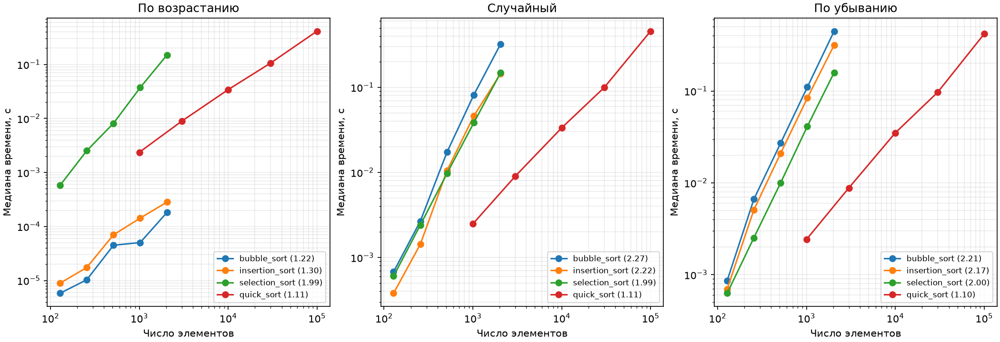

# ЛР 3. Сравнение алгоритмов сортировки

Для варианта 7 каждый размер получил свой воспроизводимый массив с начальным значением генератора 37 + n. Две его копии упорядочены по возрастанию и убыванию. Для каждого сочетания выполнены прогрев и пять повторов на исходных данных. Время включает копирование списка, для простых сортировок также учёт операций. QuickSort в каждом повторе заново получает генератор с seed 37. [Таблица всех 60 измерений и счётчиков](results.csv)

| Наклон log(t) от log(n) | По возрастанию | Случайный | По убыванию |
|---|---:|---:|---:|
| Пузырёк | 1,22 | 2,27 | 2,21 |
| Вставки | 1,30 | 2,22 | 2,17 |
| Выбор | 1,99 | 1,99 | 2,00 |
| QuickSort | 1,11 | 1,11 | 1,10 |

На упорядоченном массиве пузырёк заканчивает работу после одного прохода, а вставки делают одно сравнение для каждого следующего элемента. При n = 128 обе сортировки выполнили 127 сравнений без обменов и сдвигов. На обратном входе обе выполнили 8 128 сравнений и столько же обменов или сдвигов. У вставок учитывается сдвиг элемента вправо. Итоговая запись ключа в счётчик сдвигов не входит.

Выбор просматривает весь остаток массива независимо от порядка. Получаются n(n−1)/2 сравнений и максимум n−1 обменов. При n = 128 на случайном массиве пузырёк сделал 4 283 обмена. Число обменов зависит от числа инверсий, поэтому порядок входа влияет на время. Отклонения наклонов от 1 и 2 отражают конечный диапазон размеров, стоимость выполнения циклов Python и разброс коротких замеров.

QuickSort делит массив на элементы меньше, равные и больше случайно выбранного опорного. При достаточно сбалансированных разбиениях работа на каждом уровне линейна, а уровней порядка log n. Для n log n наклон немного больше 1 и постепенно приближается к нему. Цепочка крайних опорных на различных ключах даёт Θ(n²), хотя рандомизация делает такую цепочку маловероятной. Рекурсивно обрабатывается меньшая часть, большая продолжается в цикле. Глубина стека ограничена O(log n) даже при неудачном выборе опорных.

## Проверка стабильности и корректности

Вход состоит из пар (2, A), (2, B), (1, C). Сравнение использует только числовой ключ. Пузырёк и вставки вернули метки C, A, B. Строгое сравнение сохраняет порядок равных ключей. Выбор и QuickSort при seed 37 вернули C, B, A. Один такой пример достаточен, чтобы опровергнуть стабильность.

Для каждой реализации проверены 300 случайных массивов и пять граничных случаев, включая пустой вход и равные ключи. Равенство результата с sorted() одновременно проверяет порядок, значения и их кратности. Проверено сохранение исходного массива и точное число операций простых сортировок на прямых и обратных входах размеров от 2 до 19. Для повторной проверки выполните из корня репозитория:

~~~sh
python lab03/main.py --variant 7 --check-only
~~~
