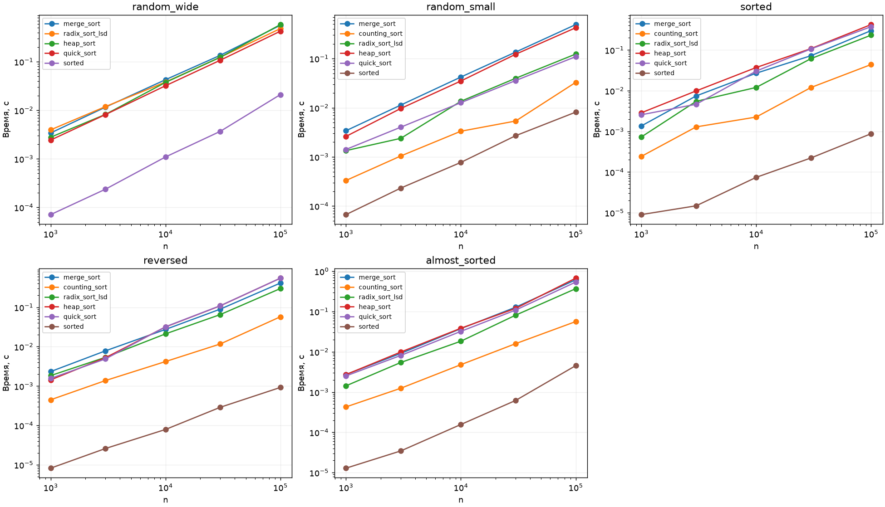

# ЛР 4. Сравнение сортировок

Вариант 7, seed 37. Каждый замер включает прогрев и пять измеряемых повторов. В таблице сохранена медиана. [Полные результаты](results.csv)

| Алгоритм | Лучший / средний / худший случай | Доп. память | Устойчивость | Область применения |
|---|---|---|---|---|
| Слияние | n log n / n log n / n log n | O(n) | Да | Сравнимые ключи, доступен вспомогательный буфер |
| Подсчёт | n+k / n+k / n+k | O(n+k) | Да | Целые ключи в компактном диапазоне |
| LSD | d(n+10) во всех случаях для d проходов | O(n+10) | Да | Неотрицательные целые, десятичные разряды |
| Куча | n на равных ключах / n log n / n log n | O(1) | Нет | Сортировка на месте |
| QuickSort ЛР 3 | n на равных ключах / n log n / n² | O(log n) стек и O(n) копия | Нет | Сравнимые ключи, случайная опора |
| sorted() | n / n log n / n log n | O(n) | Да | Адаптивен к уже упорядоченным сериям |

В таблице приведены порядки роста времени. Для подсчёта k — число возможных ключей. В реализации ключи начинаются с нуля, поэтому выделяется max+1 ячеек. В диапазоне со смещением можно вычитать min и ограничиться max−min+1. В серии random_wide верхняя граница равна миллиарду. По методике курса подсчёт для неё пропущен из-за памяти. Остальные методы измерены на всех пяти распределениях.

При слиянии равных ключей первой записывается левая запись. При подсчёте проход справа налево расставляет записи с одинаковым ключом в исходной очередности. LSD использует это свойство на каждом разряде, иначе старший проход может уничтожить порядок по младшим разрядам. Построение кучи снизу занимает O(n), поскольку большинство узлов близко к листьям. При извлечении максимума просеивается только путь от корня.

Проверены пустой массив, один элемент, повторы, случайные входы и совпадение с sorted(). На записях с метками отдельно проверена устойчивость слияния и прохода подсчётом.

**Время при n = 100 000, мс**

| Распределение | Метод с наименьшей медианой | Его время | Слияние |
| --- | --- | --- | --- |
| random_wide | sorted | 21.07 | 564.23 |
| random_small | sorted | 8.13 | 491.65 |
| sorted | sorted | 0.88 | 299.84 |
| reversed | sorted | 0.92 | 412.88 |
| almost_sorted | sorted | 4.54 | 614.67 |

Готовые монотонные серии особенно выгодны встроенной сортировке. Узкий диапазон сокращает число разрядов LSD и объём таблицы подсчёта. Различия времени включают стоимость циклов Python и встроенной реализации sorted().
