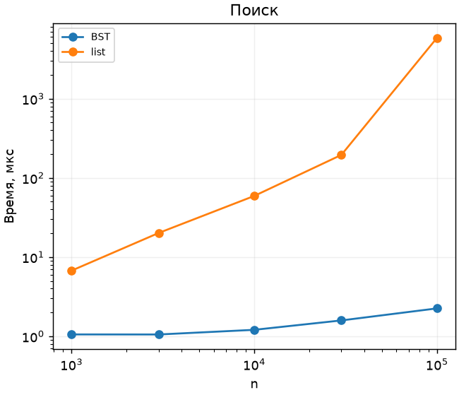

# ЛР 5. Бинарное дерево поиска

Вариант 7, seed 37. Каждый замер включает прогрев и пять измеряемых повторов. В таблице сохранена медиана. [Полные результаты](results.csv)

В каждом наборе n различных ключей вставлены в случайном порядке. По одной и той же серии из 1000 запросов вычислено время поиска в дереве и списке. Построение структур вынесено за пределы измерения.

| n | Высота в рёбрах | BST, мкс | Список, мкс |
| --- | --- | --- | --- |
| 1000 | 22 | 1.056 | 6.738 |
| 3000 | 23 | 1.054 | 20.155 |
| 10000 | 30 | 1.207 | 59.142 |
| 30000 | 32 | 1.586 | 195.048 |
| 100000 | 36 | 2.249 | 5847.870 |

При случайном порядке поддеревья обычно растут с обеих сторон, и ожидаемая высота имеет порядок log n. Рост времени линейного прохода по списку заметнее. Каждая операция BST проходит один путь, поэтому поиск, вставка и удаление занимают O(h+1). При двух детях ключ заменяется минимумом правого поддерева. Упорядоченная вставка даёт цепь высоты n−1. AVL-дерево поддерживает баланс вращениями, его высота ограничена примерно 1,44·log₂ n.

Проверены четыре обхода на деревьях с известной формой, высота пустого дерева −1, вставка дубликатов, удаление листа, узла с одним или двумя детьми и корня. На 100 случайных сериях после каждого изменения in-order сравнивается с отсортированным set. Первые три обхода рекурсивны, поэтому для глубокой вырожденной цепи действует лимит рекурсии Python.
