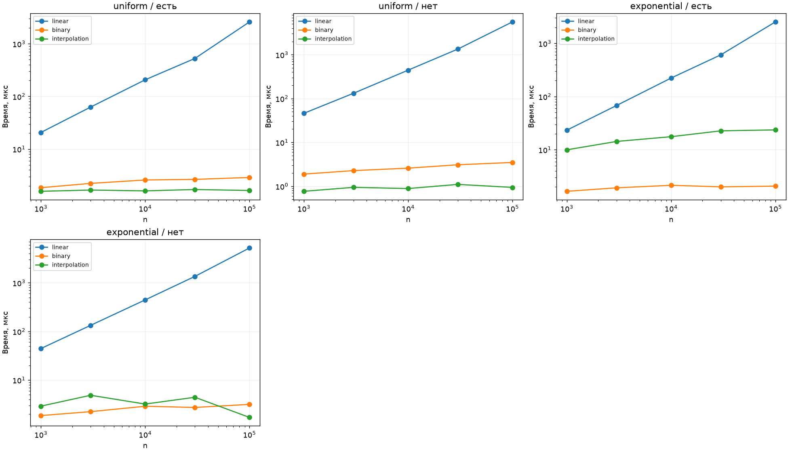
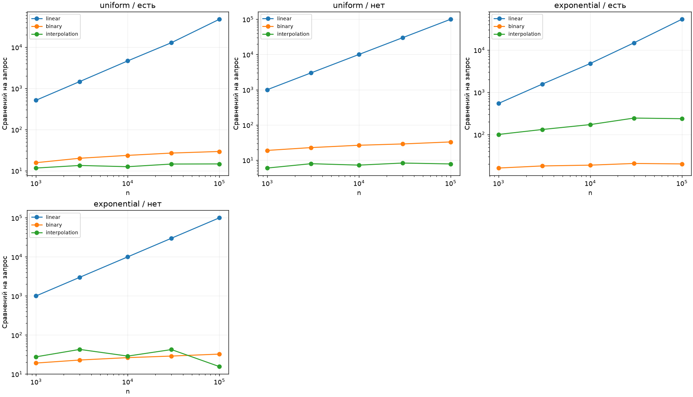

# ЛР 6. Поиск в отсортированном массиве

Вариант 7, seed 37. Каждый замер включает прогрев и пять измеряемых повторов. В таблице сохранена медиана. [Полные результаты](results.csv)

На каждую точку приходится 40 запросов одного типа. Все три метода получают одну серию. Счётчик учитывает сравнения искомого ключа с элементами массива, включая проверки выхода за границы диапазона у интерполяционного поиска.

**При n = 100 000**

| Вход | Метод | Сравнений на запрос | мкс/запрос |
| --- | --- | --- | --- |
| uniform / есть | linear | 47748.5 | 2599.29 |
| uniform / есть | binary | 29.3 | 2.88 |
| uniform / есть | interpolation | 14.6 | 1.63 |
| uniform / нет | linear | 100000.0 | 5585.43 |
| uniform / нет | binary | 32.8 | 3.48 |
| uniform / нет | interpolation | 7.8 | 0.94 |
| exponential / есть | linear | 53359.5 | 2529.96 |
| exponential / есть | binary | 20.1 | 2.07 |
| exponential / есть | interpolation | 236.8 | 23.61 |
| exponential / нет | linear | 100000.0 | 5197.09 |
| exponential / нет | binary | 32.4 | 3.16 |
| exponential / нет | interpolation | 15.5 | 1.71 |

Линейный поиск делает до n сравнений. Бинарный сохраняет возможное вхождение между lo и hi и исключает середину после промаха. Поэтому требуется O(log n) шагов при любом распределении. Интерполяция оценивает индекс по доле ключа в диапазоне значений. На равномерных успешных запросах такой прогноз точнее, ожидаемое число шагов порядка log log n. На экспоненциальных данных линейная оценка позиции искажается. В худшем случае граница продвигается всего на одну позицию и стоимость достигает O(n). Промахи вне диапазона завершаются сразу, поэтому соотношения для отсутствующих ключей иные. Арифметика прогноза также стоит времени.

Проверены пустой и одноэлементный массивы, границы, дубликаты и отсутствующие ключи. На 300 случайных примерах присутствие проверялось через in и bisect_left, первый результат линейного поиска — через list.index.
