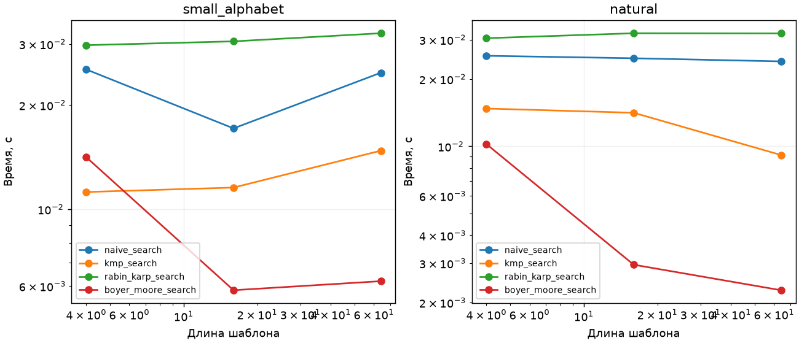
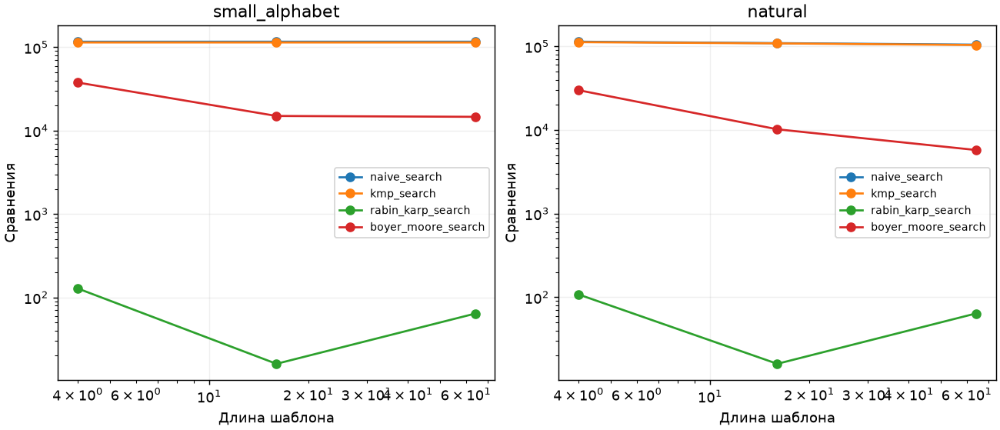

# ЛР 7. Поиск подстроки

Вариант 7, seed 37. Каждый замер включает прогрев и пять измеряемых повторов. В таблице сохранена медиана. [Полные результаты](results.csv)

Тексты длиной около 100 000 символов получены генератором курса. Для каждого текста шаблоны длины 4, 16 и 64 взяты из самого текста, поэтому имеется хотя бы одно вхождение. Время включает подготовку шаблона. Счётчики учитывают только сравнения символов при поиске в тексте. Арифметика хеша и подготовка таблиц в счётчики не входят.

| Текст | Длина | Быстрее по медиане | Медиана, мс | Вхождений |
| --- | --- | --- | --- | --- |
| small_alphabet | 4 | kmp_search | 11.21 | 32 |
| small_alphabet | 16 | boyer_moore_search | 5.83 | 1 |
| small_alphabet | 64 | boyer_moore_search | 6.19 | 1 |
| natural | 4 | boyer_moore_search | 10.22 | 27 |
| natural | 16 | boyer_moore_search | 2.95 | 1 |
| natural | 64 | boyer_moore_search | 2.27 | 1 |

Наивный алгоритм проверяет каждое выравнивание, худшая оценка O(nm). КМП за O(m) строит префикс-функцию и за O(n) проходит текст. При частичных повторах он переиспользует совпавший префикс. Рабин–Карп за O(1) обновляет хеш окна и проверяет совпадения посимвольно. Частые истинные совпадения или коллизии дают до O(nm) работы. Даже при малом числе сравнений приходится вычислять хеш каждого окна.

Бойер–Мур сочетает плохой символ и хороший суффикс. Для длинного шаблона, особенно при разнообразных символах, он может пропускать много выравниваний. При коротком алфавите несовпавший символ чаще встречается в шаблоне, что ограничивает сдвиг. Без дополнительной оптимизации повторной проверки перекрытий худшая оценка O(nm).

Для каждого эксперимента сверены все позиции со str.find с шагом один. Дополнительно проверены 300 случайных строк, пустой шаблон, перекрытия и принудительная коллизия Рабина–Карпа при модуле 1.
