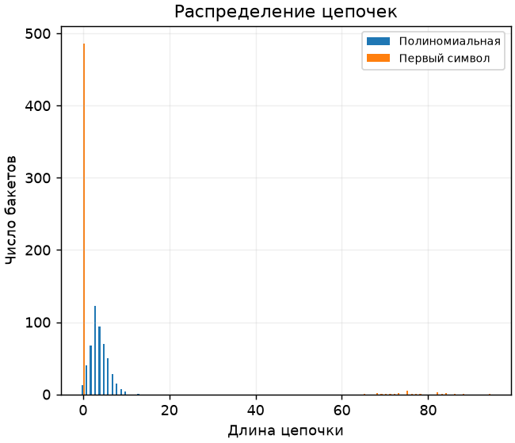
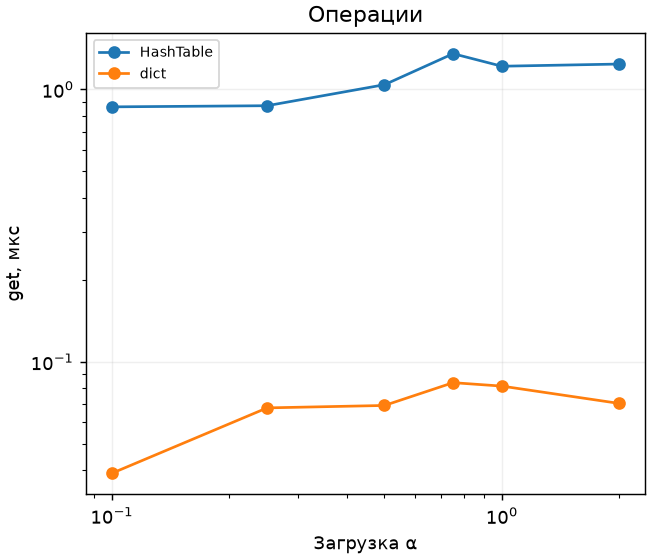
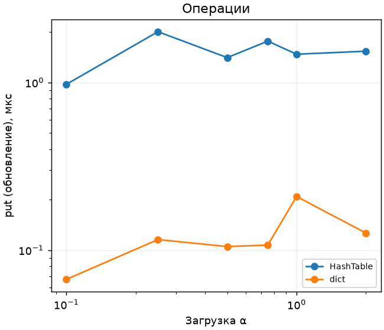
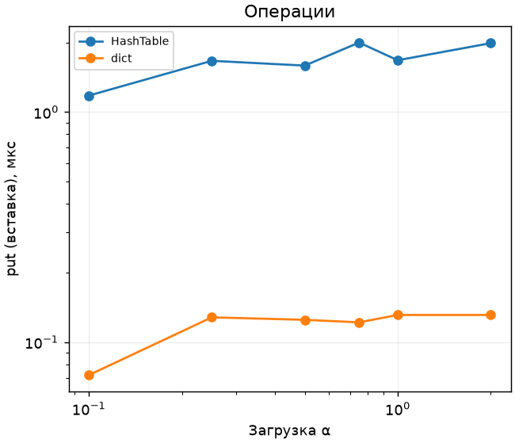

# ЛР 8. Хеш-таблица с цепочками

Вариант 7, seed 37. Каждый замер включает прогрев и пять измеряемых повторов. В таблице сохранена медиана. [Полные результаты](results.csv)

Для одинаковых 2000 ключей и 512 бакетов распределения длин цепочек получились следующими. [Частоты всех длин](chains.csv)

| Хеш | Пустых бакетов | Самая длинная цепочка |
| --- | --- | --- |
| Полиномиальная | 13 | 13 |
| Первый символ | 486 | 94 |

Полиномиальный хеш учитывает позицию и код каждого символа. Хеш по первому символу на используемом алфавите занимает максимум 26 бакетов. Длинные цепочки требуют дополнительных сравнений при поиске и обновлении.

В обычном режиме при α > 0,75 число бакетов удваивается, а индексы всех ключей вычисляются заново. Для эксперимента ёмкость фиксирована на 4096. Успешный get и обновление put измерены на 1000 запросах. Новые ключи вставлялись партиями по 32, затем удалялись вне замера. За такую партию α возрастает менее чем на 0,008.

| α | Структура | get, мкс | Обновление, мкс | Вставка, мкс |
| --- | --- | --- | --- | --- |
| 0.10 | HashTable | 0.862 | 0.972 | 1.178 |
| 0.10 | dict | 0.039 | 0.067 | 0.072 |
| 2.00 | HashTable | 1.238 | 1.534 | 1.991 |
| 2.00 | dict | 0.070 | 0.127 | 0.131 |

При равномерном распределении средняя длина цепочки равна α, ожидаемая стоимость операции для ключей фиксированной длины O(1+α). Время по точкам может колебаться: даже короткую цепочку нужно найти, вычислив хеш строки. Встроенный dict с открытой адресацией и кэшированными хешами строк быстрее собственной реализации на Python. Если все ключи попали в одну цепочку, поиск занимает O(n).

Проверены обновление существующего ключа, удаление отсутствующего, расширение и 2000 случайных операций против dict. Проверки инвариантов сверяют индекс бакета каждой пары, отсутствие дубликатов и сумму длин цепочек с размером таблицы.
